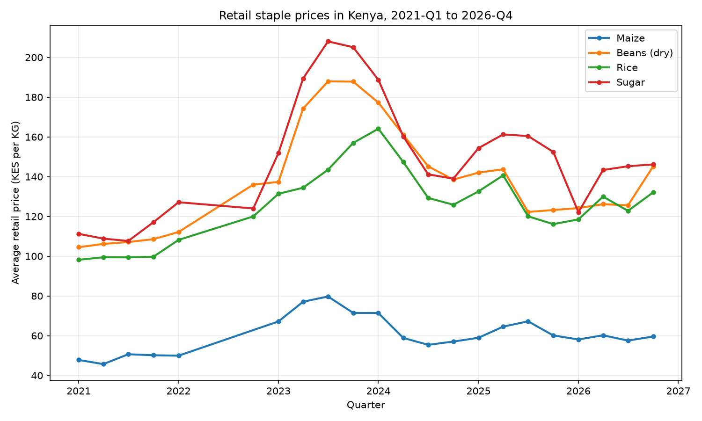
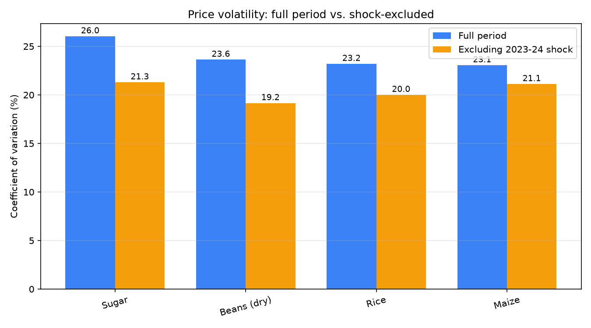

# Retail Food Price Trends and Volatility in Kenya, 2021-2026

## Abstract

Retail food prices in Kenya affect household food security directly, yet few analyses explicitly document their volatility patterns. Using 2,901 quarterly aggregate retail price records from the World Food Programme for four staple commodities (maize, dry beans, rice, sugar) between January 2021 and October 2026, we characterize price trends and volatility across the recent food price crisis. All four staples exhibited peak prices within a six-month window (Q3 2023 – Q1 2024), rising 67% to 99% above 2021-Q1 baselines. Prices partially unwound by 2026-Q4, ending 25% to 39% above baseline. Volatility analysis reveals two regimes: during the 2023–24 shock, volatility was similar across commodities (CV 23–26%), but outside the shock, volatility rankings shift, with dry beans showing the lowest and sugar and maize the highest underlying variation. Findings are reproducible via an open batch pipeline described in the methods.

## Introduction

Food price inflation in Kenya has direct consequences for household welfare. Maize, dry beans, rice, and sugar are dietary staples for most Kenyan households, and their retail prices are the primary input into household food budgets. When these prices rise, the effect is immediate: households either reduce quantities, substitute toward cheaper and less nutritious alternatives, or cut other essential spending. The scale and timing of price changes therefore matter not only as economic indicators but as measures of household food security.

Understanding how much prices rise is necessary but not sufficient. Equally important is how predictably they rise and fall. A staple whose price swings widely quarter-to-quarter imposes a different kind of burden than one whose price rises steadily: households cannot plan, small vendors cannot set prices, and policy interventions cannot anticipate crises. In the language of food security monitoring, the level of prices tells us where things are today; the volatility of prices tells us how prepared households can be for tomorrow.

Recent years have provided a natural test case. The 2022–2023 period saw a global food price crisis driven by conflict, fertilizer shortages, and regional drought. Kenya's food system was exposed to these shocks through both imports (rice, wheat, sugar) and domestic supply disruptions. Whether these shocks produced uniform or commodity-specific effects — and whether they resolved or persisted — is an empirical question that recent data can answer.

This paper addresses two questions using World Food Programme retail price data for Kenya covering January 2021 to October 2026:

RQ1 (Trend): How have retail prices for maize, dry beans, rice, and sugar changed quarter-over-quarter over this period?
RQ2 (Volatility): Which commodities have shown the highest and lowest price volatility, and does the ranking change when the 2023–2024 crisis period is excluded?
We find that all four staples exhibited peak prices within a six-month window (Q3 2023 – Q1 2024), rising 67% to 99% above their January 2021 baselines, before partially unwinding to 25% to 39% above baseline by October 2026. Volatility was broadly similar across commodities during the crisis, but diverged outside it, with dry beans showing the lowest and sugar and maize the highest underlying variation. These findings suggest that Kenya's recent food price dynamics reflect both a shared systemic shock and commodity-specific structural differences in market exposure.

The contribution of this work is twofold. First, we provide a reproducible, open-source pipeline for analyzing WFP retail price data at the commodity level, distinguishing crises from normal-period volatility. Second, we document a two-regime volatility pattern that has not been previously characterized for Kenyan staples: during the crisis, all commodities carried similar volatility; outside it, structural differences dominated.

The remainder of the paper is structured as follows. Section 2 describes the data source and methodology for handling price aggregation. Section 3 details the pipeline architecture and analytical approach. Section 4 presents trend and volatility findings. Section 5 discusses implications, Section 6 addresses limitations, and Section 7 concludes.

## Data

2.1 Source and coverage

We use retail food price data from the World Food Programme (WFP) Vulnerability Analysis and Mapping (VAM) unit, distributed through the Humanitarian Data Exchange. The dataset records prices observed or aggregated across Kenyan markets for a defined set of food commodities. The downloaded dataset covers January 2006 to October 2026 and contains 29,298 records across 51 commodities, 8 food categories, and 227 markets with price records (out of 280 markets in the metadata table). Prices are denominated in Kenyan shillings (KES); no currency conversion is required.

2.2 Structure and variables

Each record represents a price observation for a specific commodity at a specific market on a specific date, with the following relevant fields: date, commodity, category, market, admin1 (county-level region), unit, price, pricetype (Retail or Wholesale), and priceflag (actual, aggregate, or actual,aggregate). The priceflag field distinguishes direct market observations (actual) from WFP-computed aggregate prices. The unit field records the unit of measurement for each price: kilograms (KG) for most grains, produce, and meat; liters (L) for milk and cooking oil; and non-standard units for specific items (per head for cabbage, per bunch for some kale observations, per 500ml for UHT milk, per 200g for salt).

2.3 Methodology decisions

Three data quality issues required explicit treatment.

Unit heterogeneity. Because commodities are recorded in different units, prices cannot be meaningfully averaged across commodities. A price for bananas (per unit) and a price for goat meat (per kilogram) are not commensurable in the sense required for a cross-commodity average. We therefore conduct all analyses per commodity, reporting trends and volatility within each commodity's own price series rather than as a cross-commodity aggregate.

Price flag semantics. The priceflag field distinguishes WFP-published actual observations from aggregate prices. In the 2021–2026 analysis period, the aggregate series is the only continuously available series for maize, dry beans, rice, and fresh cow milk; actual observations in this period number one or zero per commodity (maize: 1; dry beans: 0; rice: 1; milk: 0). For sugar, both actual (726) and aggregate (670) series are available, with the aggregate series extending back to 2018. We use aggregate prices for all commodities, both because they are the only continuous series for the majority and because using them uniformly avoids mixing collection methods across the analysis. The 103 records flagged as actual,aggregate are excluded as ambiguous.

Commodity selection. Two exclusions narrow the analysis. First, the "non-food" category (201 records) is excluded because it does not represent food prices. Second, fresh cow milk is excluded from the primary comparison because its aggregate coverage is highly fragmented: 56 records across 24 quarters, with 14 quarters containing data and 7 of those consisting of single-market observations. Trends and volatility estimates for milk would reflect sampling artifacts rather than underlying market dynamics. Milk is retained in the database and identified as a limitation.

2.4 Structural break and analysis period

Exploratory analysis of quarterly record counts revealed a structural break in WFP's Kenyan data collection regime in 2021. Prior to 2021, quarterly record counts are approximately 24; from 2021 onward, they range from 300 to 1,700 per quarter. This discontinuity reflects a change in data collection volume rather than a change in food prices, and a naïve analysis across the full 2006–2026 period would conflate the two. We therefore restrict all analyses to the period January 2021 through October 2026, in which collection methodology and coverage are consistent. Within this period, a further gap exists in Q2 and Q3 of 2022, which affects all commodities; we report quarterly observations as recorded and note the gap where it is relevant to interpretation.

2.5 Final analysis sample

The final analysis comprises 2,901 aggregate retail price records across four commodities — maize, dry beans, rice, and sugar — from January 2021 to October 2026. Each commodity is measured in a single unit (KG) throughout this period. All analyses use these records, with the filter set: pricetype = 'Retail', priceflag = 'aggregate', category != 'non-food', date >= '2021-01-01'. The number of records per commodity is: maize 698, dry beans 765, rice 770, sugar 668. Quarterly record counts across the four analysis commodities range from 3 to 328 (mean 132); the sparsest quarters fall in the 2022 data-collection gap.

## Methods

3.1 Pipeline architecture

The analysis is implemented as a reproducible batch data pipeline with four stages: ingestion, cleaning, transformation, and serving. The pipeline runs in Docker and consists of a PostgreSQL database container for storage and computation, a set of SQL scripts for data transformation, and a Python script for exporting analysis-ready outputs to CSV. The complete pipeline, including all source files and configuration, is version-controlled and available in the project repository.

Ingestion. Raw WFP CSV files are loaded into a PostgreSQL table (food_prices) via a schema-definition and seed script executed on first container startup. The raw table preserves all 16 original columns with no filtering or transformation, so that every analysis step is reproducible from the original source.

Cleaning. A cleaning script (transform/01_clean.sql) creates a derived table (clean_food_prices) by applying the filter set described in Section 2.5 and casting the date field to a proper date type. The cleaning step is idempotent: it drops the derived table if it exists and recreates it from the raw table, ensuring re-execution produces identical results and never accumulates duplicate rows.

Transformation. Two analysis tables are generated from the cleaned data. quarterly_trends aggregates each commodity's prices by calendar quarter (DATE_TRUNC('quarter', date)), computing record counts, mean price, minimum, maximum, and standard deviation. commodity_volatility computes per-commodity summary statistics including the coefficient of variation over the full analysis period and separately over the period excluding the 2023–2024 crisis window. Both transformation tables carry a loaded_at timestamp column recording the time of generation, providing traceability for every analysis output.

Serving. A Python script (serve/export_summary.py) connects to the database and exports both analysis tables to timestamped CSV files. These are the tables used to produce the findings in Section 4. The script reads database credentials from environment variables loaded from a local .env file, so no credentials are stored in the repository.

3.2 Analytical approach for RQ1 (trend)

To characterize price trends (RQ1), we compute for each commodity the quarterly mean aggregate retail price over 2021-Q1 through 2026-Q4. We report three summary statistics per commodity: the starting price (2021-Q1), the peak price (the highest quarterly mean within the period) and its quarter, and the ending price (2026-Q4). We express changes as percentage differences from the 2021-Q1 baseline. This per-commodity approach avoids the unit-heterogeneity problem described in Section 2.3 — each commodity is compared only to its own baseline, and no cross-commodity averaging is performed.

3.3 Analytical approach for RQ2 (volatility)

To characterize price volatility (RQ2), we use the coefficient of variation (CV), defined as the standard deviation of quarterly prices divided by the mean price, expressed as a percentage. The CV is unit-free, allowing fair comparison of volatility across commodities with different absolute price levels. Raw standard deviation is not comparable across commodities in the way required here: a commodity priced at KES 100/kg will mechanically show a lower standard deviation than a commodity priced at KES 500/kg even if their relative price swings are identical. The CV corrects for this.

We compute the CV twice per commodity. First, over the full analysis period (2021-Q1 to 2026-Q4), which captures both crisis-driven and normal-period variation. Second, excluding the 2023-Q3 to 2024-Q2 window — the period bracketing the peak identified in RQ1 — which isolates the underlying (non-crisis) volatility. The difference between the two values indicates how much of each commodity's measured volatility is attributable to the crisis period versus structural market factors.

3.4 Data quality verification

All transformation stages are followed by automated verification. A test suite (tests/test_pipeline.sql) consists of six assertions that check: (i) source data exists; (ii) the cleaning stage produces the expected row volume; (iii) only retail aggregate rows are present in the cleaned table; (iv) no null prices are present; (v) the trend table contains all four analysis commodities; and (vi) the volatility table is populated with valid coefficient-of-variation values. Any assertion failure aborts the test run, ensuring that broken or mis-filtered outputs are detected before they can propagate into the analysis.

3.5 Reproducibility

The pipeline can be fully reproduced from the repository with three commands after cloning and configuring credentials (as documented in the repository's README): make pipeline rebuilds the cleaned and analysis tables and exports the CSVs, make test runs the data quality suite, and ./run_pipeline.sh executes both with per-run logging to logs/. Every analysis table carries a loaded_at timestamp, so any CSV can be traced to a specific pipeline execution.

## Results

4.1 Price trends (RQ1)

Table 1 summarizes the quarterly retail price trajectory for each of the four analysis commodities over the 2021-Q1 to 2026-Q4 period.

**Table 1. Retail price trends by commodity, 2021-Q1 to 2026-Q4 (KES per KG)**

| Commodity | Start (2021-Q1) | Peak | Peak quarter | End (2026-Q4) | Peak change | Total change |
|---|---|---|---|---|---|---|
| Maize | 47.78 | 79.70 | 2023-Q3 | 59.58 | +66.8% | +24.7% |
| Dry beans | 104.50 | 187.92 | 2023-Q3 | 145.16 | +79.8% | +38.9% |
| Rice | 98.17 | 164.11 | 2024-Q1 | 132.09 | +67.1% | +34.6% |
| Sugar | 111.22 | 221.52 | 2023-Q4 | 155.03 | +99.1% | +39.4% |

*Figure 1. Quarterly average retail prices for four staple commodities. All four peaks occur within a six-month window (Q3 2023 to Q1 2024), suggesting a common systemic shock.*

Two patterns are immediately visible. First, all four commodities exhibited peak prices within a six-month window: maize and dry beans in Q3 2023, sugar in Q4 2023, and rice in Q1 2024. The synchronization across four commodities with distinct market structures (domestic staples, imported goods) suggests a shared underlying shock rather than commodity-specific factors. Second, all four commodities partially unwound from their peaks by 2026-Q4, giving back between 32 and 60 percentage points of their peak gains. Total price increases over the full period were substantially smaller than peak increases — ranging from +24.7% (maize) to +39.4% (sugar) — but still materially higher than the 2021 baseline.

Sugar showed the largest peak increase (+99.1%), nearly doubling at its Q4 2023 maximum before falling 30% by 2026-Q4. Maize showed the smallest peak increase (+66.8%), consistent with its position as Kenya's most widely traded staple and the commodity most exposed to domestic policy interventions. The three other commodities fell between these two, with dry beans (+79.8%) and rice (+67.1%) at intermediate magnitudes.

A data gap in Q2 and Q3 of 2022 affects all four commodities and complicates interpretation of the 2022–2023 rise. The 2023-Q1 price for each commodity is substantially higher than the last observed 2022-Q1 value, but the trajectory within the gap cannot be observed.

4.2 Volatility, full period (RQ2a)

Table 2 presents the coefficient of variation (CV) for each commodity over the full 2021-Q1 to 2026-Q4 period.

Table 2. Full-period coefficient of variation by commodity, 2021-Q1 to 2026-Q4

Commodity	Mean price (KES/kg)	Std dev	CV (%)
Sugar	140.97	36.71	26.04
Dry beans	132.45	31.30	23.63
Rice	121.02	28.08	23.20
Maize	57.95	13.36	23.06
The full-period CVs cluster tightly, ranging from 23.06% (maize) to 26.04% (sugar) — a spread of just 3 percentage points. In relative terms, all four commodities are roughly equally volatile across the crisis-inclusive period. This is notable because it contrasts with the raw standard deviations, which range from 13.36 (maize) to 36.71 (sugar) — a nearly three-fold difference. The raw standard deviations are dominated by differences in absolute price levels, not in underlying market volatility. The CV corrects for this and reveals that the four commodities carry similar relative price uncertainty.

4.3 Volatility, shock-excluded (RQ2b)

Table 3 recomputes the CV excluding the 2023-Q3 to 2024-Q2 window — the period bracketing the peak identified in Section 4.1. This isolates the underlying volatility outside the crisis period.

**Table 3. Shock-excluded coefficient of variation by commodity, 2021-Q1 to 2026-Q4 (excluding 2023-Q3 to 2024-Q2)**

| Commodity | Mean price (KES/kg) | Std dev | CV (%) | Change from full period |
|---|---|---|---|---|
| Sugar | 131.13 | 27.93 | 21.30 | −4.74 |
| Maize | 55.41 | 11.70 | 21.12 | −1.94 |
| Rice | 114.61 | 22.94 | 20.01 | −3.19 |
| Dry beans | 122.98 | 23.56 | 19.16 | −4.47 |

*Figure 2. Coefficient of variation for the full analysis period and for the shock-excluded period. Removing the 2023–2024 crisis window lowers volatility for all commodities and reverses the ranking of maize relative to dry beans.*

Two findings emerge. First, removing the crisis window lowers CVs for all four commodities (by 1.9 to 4.7 percentage points), confirming that the crisis period accounts for a meaningful share of measured volatility. Second, the ranking reverses. In the full-period analysis, maize had the lowest CV (23.06%) and sugar the highest (26.04%). Outside the crisis, dry beans have the lowest CV (19.16%) and sugar the highest (21.30%), with maize now the second-most volatile commodity (21.12%). This reversal is substantive: maize's apparent stability in the full-period analysis was driven by the crisis period, not by lower normal-period volatility.

4.4 Summary of findings

The two analyses t### 4.3 Volatility, shock-excluded (RQ2b)

Table 3 recomputes the CV excluding the 2023-Q3 to 2024-Q2 window — the period bracketing the peak identified in Section 4.1. This isolates the underlying volatility outside the crisis period.

**Table 3. Shock-excluded coefficient of variation by commodity, 2021-Q1 to 2026-Q4 (excluding 2023-Q3 to 2024-Q2)**

| Commodity | Mean price (KES/kg) | Std dev | CV (%) | Change from full period |
|---|---|---|---|---|
| Sugar | 131.13 | 27.93 | 21.30 | −4.74 |
| Maize | 55.41 | 11.70 | 21.12 | −1.94 |
| Rice | 114.61 | 22.94 | 20.01 | −3.19 |
| Dry beans | 122.98 | 23.56 | 19.16 | −4.47 |

*Figure 2. Coefficient of variation for the full analysis period and for the shock-excluded period. Removing the 2023–2024 crisis window lowers volatility for all commodities and reverses the ranking of maize relative to dry beans.*

Two findings emerge. First, removing the crisis window lowers CVs for all four commodities (by 1.9 to 4.7 percentage points), confirming that the crisis period accounts for a meaningful share of measured volatility. Second, the ranking reverses. In the full-period analysis, maize had the lowest CV (23.06%) and sugar the highest (26.04%). Outside the crisis, dry beans have the lowest CV (19.16%) and sugar the highest (21.30%), with maize now the second-most volatile commodity (21.12%). This reversal is substantive: maize's apparent stability in the full-period analysis was driven by the crisis period, not by lower normal-period volatility.ogether describe a two-regime volatility pattern. During the 2023–2024 shock, all four staples carried similar relative volatility (CV 23–26%). Outside the shock, commodity-specific factors dominate: sugar (a globally traded commodity) and maize (Kenya's most policy-exposed staple) show the highest underlying volatility, while dry beans (a predominantly domestically sourced commodity) show the lowest. The gap between the most and least volatile commodity narrows from 3.0 percentage points (full-period) to 2.1 percentage points (shock-excluded), but the reordering indicates that different commodities face different structural volatility drivers.

The peak-price synchronization documented in Section 4.1 suggests a common systemic shock; the volatility divergence documented in Section 4.3 suggests commodity-specific structural differences that persist outside crisis periods. These two findings are not in tension: the shock affected all commodities, but the underlying volatility — the quarter-to-quarter jitter absent a crisis — differs across commodities in ways that reflect their distinct market exposures.

## Discussion

5.1 A shared shock, partially unwound

All four commodities peaked at almost the same time. Maize and dry beans peaked in Q3 2023. Sugar peaked in Q4 2023. Rice peaked in Q1 2024. That is a six-month window across four very different commodities. Maize is Kenya's main staple and the most government-regulated. Rice is mostly imported. Sugar is partly imported and partly grown in Kenya. Dry beans are mostly grown in Kenya. These markets do not normally move together. That they peaked together suggests one common cause, not four separate ones.

The timing matches the 2022–2023 global food price crisis. That crisis had several causes at once: grain export disruptions after the war in Ukraine, high fertilizer prices, and drought in East Africa. Kenya was exposed through imports (rice, sugar) and through domestic supply problems. The data cannot prove that these events caused the price peaks. We do not have fuel prices, fertilizer prices, or rainfall data in this dataset. What we can say is that the timing fits a common shock. We cannot say it proves one.

Prices did not stay at their peaks. By 2026-Q4, every commodity had given back between one-half and three-fifths of its peak gain. This suggests the price shock was temporary at the retail level. Prices did not return to their 2021 levels — they stayed 25–39% higher over the full period. But they also did not stay at the 2023–2024 peak. A permanent increase would have suggested a permanent change in supply or in the currency. What we see instead is a severe but temporary event.

5.2 Two volatility regimes

The volatility results show something new. When we measure volatility over the whole period, all four commodities look similar (CV 23–26%). When we remove the 2023–2024 crisis window and measure again, the ranking changes. Dry beans become the least volatile. Maize and sugar become the most volatile.

This matters for two reasons.

First, it means maize is not as stable as it looks. In the full-period numbers, maize had the lowest CV. That made it look like the safest staple. But that was only because maize's crisis peak was smaller than sugar's. Maize's normal quarter-to-quarter price movement is actually among the highest in the group. A household buying maize faces about the same price uncertainty as one buying sugar — and more uncertainty than one buying dry beans.

Second, the different commodities appear to be volatile for different reasons. Sugar is volatile because its price depends on global markets and the exchange rate. Maize is volatile because of seasonal supply cycles and government policy changes. Dry beans are the most stable, probably because they are grown and sold mostly inside Kenya, with fewer outside shocks. The data cannot confirm these explanations directly. But the pattern is consistent with them.

5.3 Implications

For households: food price risk is spread across staples, not concentrated in one. All four commodities show real quarterly price swings. During a systemic shock, they all spike at once. A household cannot avoid the risk just by switching from one staple to another. The risk is broad.

For policy: crisis-period interventions and structural interventions solve different problems. Crisis interventions — price controls, reserve releases, tariff changes — address events like 2023–2024. Structural interventions — storage, domestic production support, market information systems — address the normal-period volatility differences we found in Section 4.3. Both matter. Neither replaces the other.

For monitoring: volatility should be reported separately for crisis and non-crisis periods. A single CV across a multi-year window mixes the two regimes. That can hide the commodity-specific patterns that matter most for policy.

5.4 Scope of these findings

Three limits shape how far these findings reach. First, the analysis covers 2021–2026 only. We excluded earlier years because WFP changed how it collected data in 2021, and mixing the two periods would confuse a change in measurement with a change in prices. So the findings describe the modern data regime, not a twenty-year trend. Second, we use WFP aggregate prices, not individual transaction prices. The findings describe market-level patterns, not what any one buyer paid. Third, fresh cow milk was excluded because its coverage was too thin for reliable estimates. The findings do not extend to dairy. Section 6 discusses these limits in more detail.

## Limitations

This analysis has five limitations that shape what the findings can and cannot support.

6.1 Coverage is 2021–2026 only

WFP changed how it collected Kenyan price data in 2021. Before that year, roughly 24 records were published per quarter; from 2021 onward, the count ranges from 300 to 1,700 per quarter. Mixing these two periods would confuse a change in measurement with a change in prices. So the analysis covers 2021–2026 only. The findings describe the modern WFP collection regime, not a twenty-year trend. Any conclusion about longer-term patterns — for example, whether Kenyan staple prices have risen faster or slower than inflation over two decades — would require a different analysis that carefully reconciles the pre-2021 and post-2021 series.

6.2 Aggregate prices, not transaction prices

All analyses use WFP aggregate prices, which are market-level summaries rather than individual transaction prices. A household in Nairobi and a household in Turkana both pay retail prices, but they do not pay the same retail prices — and neither is necessarily close to the WFP aggregate for their region. The findings describe market-level patterns, not individual-level costs.

6.3 Dairy is excluded

Fresh cow milk is excluded from the primary comparison because its aggregate coverage is highly fragmented: 56 records across 24 quarters, with 7 of 14 data-bearing quarters consisting of single-market observations. Volatility estimates for milk would reflect which market happened to report, not underlying dairy price dynamics. The findings do not extend to dairy products.

6.4 A data gap in mid-2022

WFP records contain a gap in Q2 and Q3 of 2022 for all four commodities. The trend analysis reports the last observed pre-gap price (2022-Q1) and the first post-gap price (2023-Q1), but the trajectory between them is unobserved. This gap complicates interpretation of the 2022–2023 price rise — we cannot distinguish a rapid jump from a gradual increase, or identify exactly when the crisis began in retail prices.

6.5 No causal identification

The analysis documents that prices rose sharply in 2023–2024 and partially unwound by 2026. It does not identify the causes of these movements. The timing is consistent with the 2022–2023 global food price crisis, but many things happened during that period — conflict, drought, fertilizer shortages, exchange-rate changes, policy interventions — and the dataset does not include the variables required to separate their contributions. The two-regime volatility finding is descriptive: it shows that different commodities carry different underlying volatility, not why.

## Conclusion

This paper asked two questions about Kenyan staple food prices between 2021 and 2026: how have retail prices changed, and which commodities are most volatile?

On the first question, all four staples — maize, dry beans, rice, and sugar — rose sharply, peaked within a six-month window in 2023–2024, and then partially unwound. At peak, prices were 67–99% above their January 2021 levels. By October 2026, they remained 25–39% higher. The synchronized timing suggests a common shock rather than four separate causes. The partial unwinding suggests the shock was severe but temporary, not a permanent shift in price levels.

On the second question, the answer depends on how you measure. Across the full period, all four staples carried similar relative volatility (CV 23–26%). Outside the crisis period, the ranking changed: dry beans became the most stable, maize and sugar the least. This is the paper's main contribution. It shows that a single volatility number can hide the difference between "volatile because of a crisis" and "volatile in normal times" — and that the two mean different things for households, for policy, and for monitoring.

The pipeline that produced these findings is open, reproducible, and tested. The methods describe how to rebuild it from the raw data. The point of that design is simple: anyone who wants to check the numbers, extend the analysis, or apply the same approach to a different country or commodity set can do so without starting from scratch.

Food prices change every month. This paper describes one way to keep watching them.

## References

Food and Agriculture Organization of the United Nations. (2023). FAO Food Price Index. https://www.fao.org/worldfoodsituation/foodpricesindex/en/

Food and Agriculture Organization of the United Nations. (2024). The State of Food Security and Nutrition in the World 2024. Rome: FAO.

Minot, N. (2011). Transmission of World Food Price Changes to Markets in Sub-Saharan Africa. IFPRI Discussion Paper 1059. Washington, DC: International Food Policy Research Institute.

World Bank. (2023). Food Security Update (multiple issues, 2022–2023). Washington, DC: World Bank.

World Food Programme. (2024). Kenya - Food Prices. Humanitarian Data Exchange. https://data.humdata.org/dataset/wfp-food-prices-for-kenya

World Food Programme. (2024). Vulnerability Analysis and Mapping (VAM) Food Prices Database — Technical Notes. Rome: WFP.

[Additional references on Kenyan food markets, the 2022–2023 global food crisis, and volatility methodology — to be added during final review]
